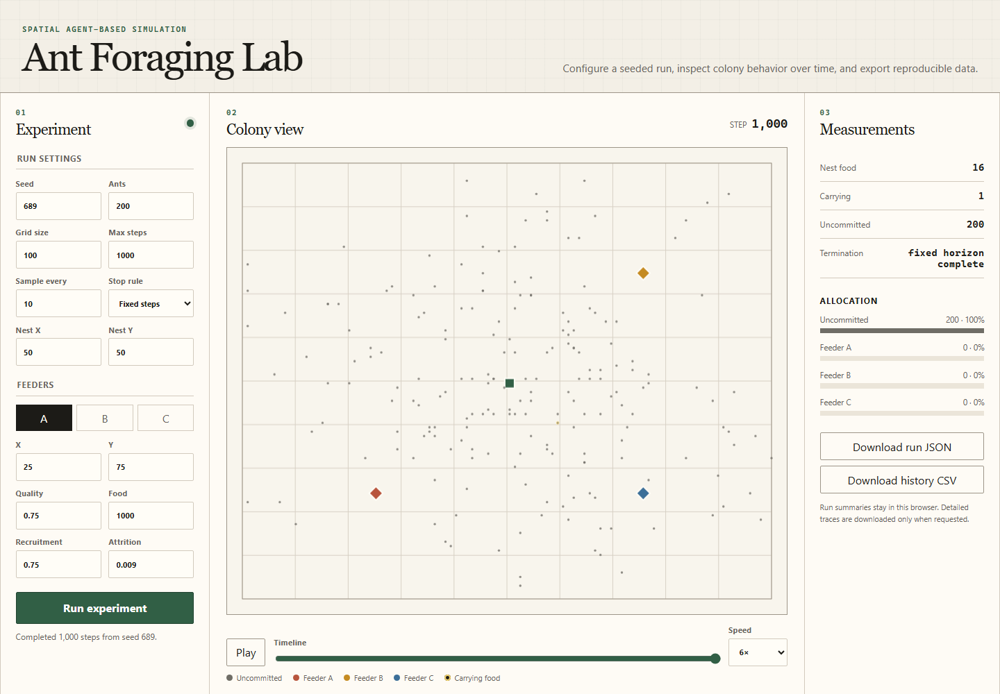

# Ant Foraging Lab

Ant Foraging Lab is a reproducible spatial agent-based simulation for exploring collective foraging behavior. Ants discover food sources, recruit nestmates after returning food, carry food to a nest, and lose commitments through attrition. A browser interface makes seeded runs visible and exports their configurations, sampled trajectories, and outcomes.

The project is inspired by collective-allocation questions discussed in:

> Shaffer, Z., Sasaki, T., & Pratt, S. C. (2013). Linear recruitment leads to allocation and flexibility in collective foraging by ants. *Animal Behaviour, 86*(5), 967–975.

> [!IMPORTANT]
> This is a simplified stochastic agent-based model. It is not a genetic algorithm and its output should not be treated as biological ground truth.



## Try the interactive lab

Requirements: Python 3.11+ and [`uv`](https://docs.astral.sh/uv/).

```bash
uv sync
uv run ant-foraging-lab-web
```

Open <http://127.0.0.1:8000> and choose a seed, run length, colony size, stopping rule, and feeder parameters.

The interface provides:

- guided, reference, and matched recruitment-off presets;
- an in-page guide explaining every variable and its expected directional effect;
- an animated spatial replay of ants, the nest, and three feeders;
- live commitment, carrying, inventory, and nest-delivery measurements;
- a timeline-aware log of feeder discoveries, delivery and recruitment milestones, depletion, and completion;
- a sampled food-inventory time series;
- browser-local run history;
- detailed JSON trace downloads and summary CSV exports.

Run history is stored only in the browser's local storage. The application does not send experiment results to an external analytics or persistence service.

## Reproducibility contract

Every recorded experiment includes:

- the trace schema, package version, model version, Python version, and random-generator family;
- a named scenario or `custom` provenance label;
- the random seed used by the simulation;
- grid, nest, colony, feeder, and stopping-rule configuration;
- the number of completed steps and termination reason;
- sampled ant positions and states;
- significant events recorded at their exact simulation steps;
- feeder inventory, carried food, nest deliveries, and commitment counts.

A run is bounded by `max_steps`. Repeating the same configuration and seed with the same recorded model and runtime provenance produces the same trace. Custom random sources must provide their own explicit seed provenance before a result can be recorded.

## Multi-seed comparison

Run the paired recruitment and no-recruitment comparison with:

```bash
uv run ant-foraging-lab-batch --seeds 0:30 --max-steps 2000
```

The model 0.2.0 experiment used 30 paired seeds. Nest recruitment delivered a mean of 43.7 food units versus 42.4 without recruitment, but the paired median difference was zero and variation was large relative to the observed difference. The result does not support a claim of a robust recruitment advantage under this single configuration. See the [full methods, preserved raw results, limitations, and generated figure](docs/experiments/recruitment-comparison.md).

## Model behavior

The corrected model under `src/ant_foraging_lab/` uses explicit timestep phases:

1. Ants move toward a committed feeder, return food to the nest, or explore one neighboring cell.
2. Feeder discovery occurs only when an ant occupies that feeder's cell.
3. Each ant committed at the beginning of the step may recruit only after returning to the nest and depositing any carried food.
4. The recruiter uniformly selects one eligible uncommitted ant at the nest and performs one Bernoulli trial.
5. Recruitment and attrition decisions are staged and then applied together.

These rules model recruitment as a nest-based interaction and prevent repeated attempts, same-step recruitment cascades, and dependence on the internal ant-list order. See [`docs/model-semantics.md`](docs/model-semantics.md) for the complete contract.

Supported termination policies are:

- fixed duration;
- first feeder depleted;
- all feeders depleted;
- an absolute maximum-step safety bound for every run.

Fixed-duration runs are the default because compared strategies receive the same observation period.

## Repository layout

```text
src/ant_foraging_lab/
  model.py              Simulation state and timestep rules
  scenarios.py          Named reproducible configurations
  experiment.py         Sampled traces and browser-ready records
  batch.py              Paired multi-seed experiment runner
  analysis.py           Descriptive summaries and generated SVG figure
  web.py                FastAPI application and input validation
  static/               Interactive browser interface
tests/                  Model, invariant, experiment, and API tests
docs/                   Semantics, experiment results, web-lab guide, and roadmap
```

Private source records and submission materials are intentionally excluded from this public project.

## Programmatic use

```python
from ant_foraging_lab import Simulation
from ant_foraging_lab.scenarios import three_feeder_scenario

config = three_feeder_scenario(seed=689, max_steps=2_000)
result = Simulation(config).run()
print(result)
```

The HTTP API is available at `POST /api/runs`; FastAPI also exposes interactive schema documentation at <http://127.0.0.1:8000/docs> while the server is running. Request and export details are documented in [`docs/web-lab.md`](docs/web-lab.md).

## Development

```bash
uv sync
uv run pytest
uvx ruff check src tests
```

The test suite covers seeded repeatability, spatial bounds, recruitment semantics, synchronous updates, food conservation, termination behavior, trace sampling, API validation, and package imports.

Contributions should keep simulation state independent from presentation code, inject all randomness, preserve bounded execution, and add tests for behavioral changes. See [`CONTRIBUTING.md`](CONTRIBUTING.md).

## Documentation

| Document | Purpose |
| --- | --- |
| [`docs/model-semantics.md`](docs/model-semantics.md) | Authoritative movement and social-update rules |
| [`docs/web-lab.md`](docs/web-lab.md) | Browser controls, API format, and data exports |
| [`docs/experiments/recruitment-comparison.md`](docs/experiments/recruitment-comparison.md) | Multi-seed baseline comparison, raw data, and generated figure |
| [`docs/roadmap.md`](docs/roadmap.md) | Planned experiment and evaluation milestones |

## Scientific scope and limitations

The model intentionally simplifies navigation, recruitment, memory, resource transport, and biological heterogeneity. Results establish behavior of this implementation—not claims about real ant colonies. Statistical comparisons should use multiple predetermined seeds and report full distributions or justified uncertainty intervals rather than interpreting one run.

A possible future evolutionary-computation experiment is kept separate from the current model. Calling that extension genetic or evolutionary will require an explicit population, genome, fitness function, selection, recombination, mutation, and generations.

## License

The independently authored active project is available under the [MIT License](LICENSE). The cited research remains the work of its respective authors and is referenced for scientific context.
