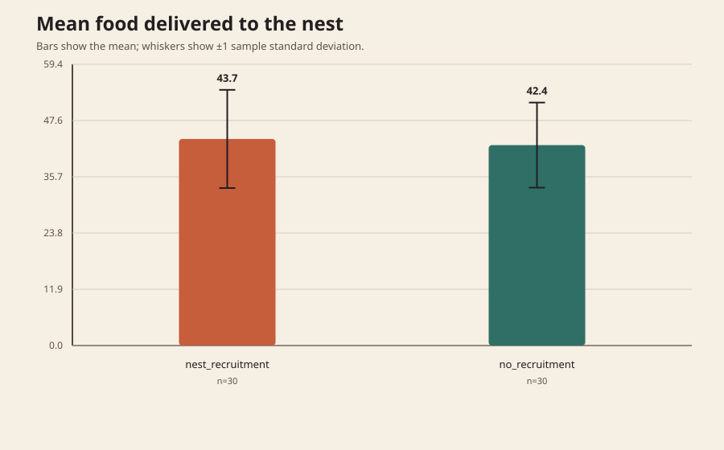

# Recruitment comparison — model 0.2.0

## Question

Under the documented nest-based recruitment semantics, does enabling recruitment change total food delivered to the nest over a fixed 2,000-step horizon relative to an otherwise matched no-recruitment baseline?

This is a narrow software-model comparison, not a claim about biological ants.

## Reproduction

```bash
uv run ant-foraging-lab-batch \
  --seeds 0:30 \
  --max-steps 2000 \
  --output-dir results/recruitment-comparison
```

The batch pairs the same 30 seeds across two scenarios:

- `nest_recruitment` — the documented three-feeder configuration with recruitment rate `0.75`;
- `no_recruitment` — the same configuration with only recruitment rates changed to `0.0`.

Both scenarios use 200 ants, a 100 × 100 grid, three equal feeders, fixed-horizon termination, model version `0.2.0`, and Python's `random.Random` generator. Complete configuration columns and outcomes are preserved in [`runs.csv`](recruitment-comparison/runs.csv); the seed schedule, version, and SHA-256 digest of every generated output are preserved in [`manifest.json`](recruitment-comparison/manifest.json).

## Descriptive result

| Scenario | Runs | Mean delivered | Median | Sample SD | Range |
| --- | ---: | ---: | ---: | ---: | ---: |
| Nest recruitment | 30 | 43.7 | 42.0 | 10.4 | 29–68 |
| No recruitment | 30 | 42.4 | 41.5 | 9.0 | 29–62 |

The paired mean difference was **+1.3 food units** for nest recruitment, with a paired median difference of **0** and paired sample SD of **7.8**. Of the 30 paired seeds, recruitment produced more deliveries in 10, the same number in 14, and fewer in 6. An exploratory paired t interval for the mean difference was approximately **−1.6 to +4.2** food units.



## Interpretation

The observed difference is small relative to run-to-run variability and is not consistently positive across seeds. This experiment therefore does **not** support a claim that nest-based recruitment robustly improves delivery under this configuration and horizon. Its stronger portfolio value is methodological: the model now has an explicit baseline, paired seed schedule, preserved raw results, versioned provenance, descriptive spread, and a generated figure.

## Limitations and next experiments

- Only one spatial layout, colony size, horizon, and recruitment rate were compared.
- The outcome is aggregate nest delivery; feeder-of-origin delivery is not yet tracked.
- The model is a simplified abstraction and was not calibrated against empirical ant data.
- The approximate interval is exploratory and was not part of a preregistered hypothesis test.
- Follow-up sensitivity analysis should vary recruitment rate, horizon, feeder distance, and colony size while preserving held-out seed schedules.
